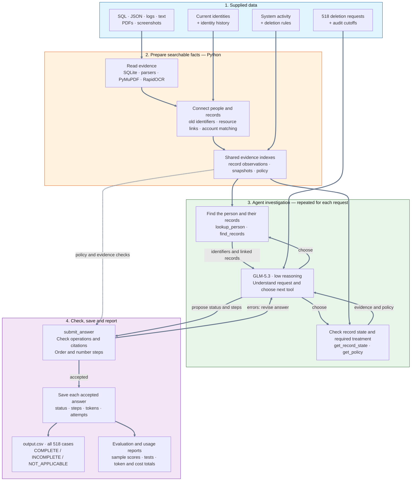

# Ghost Data Still Exists

An AI-powered **deletion-audit agent** that checks whether a person's data was actually deleted—not just whether a workflow reported success.

Built for the HackerRank Orchestrate **Ghost Data Still Exists** challenge (October 2026). For each of **518 requests**, the agent reads the request, resolves current and historical identities, investigates evidence across services, applies the supplied deletion policy, and returns **`COMPLETE`**, **`INCOMPLETE`**, or **`NOT_APPLICABLE`** with an ordered, evidence-backed action plan.

**GLM-5.3 chooses the investigation tools and makes the assessment.** Python reads and links the evidence, exposes policy rules, and checks the submitted answer. This is a tool-using agent, not a fixed sequence of model prompts.

```text
case_id,deletion_status,steps_json
```

---

## The Problem

A deletion can look finished while personal data remains in a failover database, support attachment, export, search index or backup. A synchronization job or restore process can also bring deleted data back.

The agent must answer three questions:

1. **Was deletion authorized?** An access request, correction, export or marketing opt-out is not an account-deletion request.
2. **What was true at `audit_at`?** Workflow statuses and activity results are claims, not proof that every copy was cleaned.
3. **What treatment does policy require?** Some records must be deleted; others must be redacted, anonymized or retained. Account tombstones may keep a stable internal reference, but not prohibited direct identifiers.

For incomplete deletions, the output reports the remaining data and recreation risks, then lists remediation and verification steps. The application **plans these actions; it does not execute deletions against live services**.

Full specification: [problem_statement.md](problem_statement.md).

---

## Features

- **Tool-driven investigation:** The model chooses which person, record and policy tools to call and when to submit an answer.
- **Historical identity matching:** Current and previous emails, phones, names and hashes help connect records that no longer use the request email.
- **Mixed-format evidence:** SQLite-compatible SQL exports, JSON, logs, plain text, PDFs and screenshots become searchable evidence rows.
- **Replica-aware checks:** A clean primary snapshot does not prove that a failover or reporting copy is clean. Absence checks compare the same table or collection.
- **Policy-aware planning:** Delete, redact, anonymize, retain, disable a data flow or block a restore according to the supplied rules.
- **Evidence and time checks:** Findings and completed-state verification require acceptable evidence references. Files captured after the audit cutoff cannot be cited.
- **Checked submission:** Invalid operations or evidence produce feedback to the agent; accepted steps are deduplicated, ordered and numbered.
- **Resumable runs:** Successful answers and token usage are saved per case. Reusing a run tag skips saved successes and retries unfinished cases.
- **Measured evaluation:** Public-sample scoring, six offline tool tests and a combined usage report for all 518 final requests.

---

## Architecture

Read from top to bottom: **load the evidence → connect records to people → let the agent investigate → check and save its answer**.



**How to read the agent loop:** GLM-5.3 asks a tool for facts, reads its reply, then decides what to check next. Once it has an answer, `submit_answer` checks it. A rejected answer goes back to the agent for correction; an accepted answer is saved. The reporting commands summarize saved results separately—they are not tools the agent calls.

Evidence preparation is deterministic code; **the investigation is model-directed**. There is no fixed tool-call order. For example, the agent can inspect a suspicious record, ask for its policy, investigate another copy, and revise its answer after validation feedback.

### Agent tools

| Tool | Purpose |
|---|---|
| `lookup_person` | Resolve the request email to a person and recover current and historical identifiers. |
| `find_records` | List records linked to that person, with their systems and supporting links. |
| `get_record_state` | Inspect observations, activity claims and relevant snapshots up to the audit cutoff. |
| `get_policy` | Return the record category, required treatment and permitted operations. |
| `submit_answer` | Check the proposed status and steps; return errors or an accepted, ordered answer. |

The normal tool budget is 25. Once exhausted, the loop allows up to three additional submission-only turns. A case that still cannot produce a valid submission is saved as failed and retried, rather than assigned a made-up status.

Detailed design: [code/ARCHITECTURE.md](code/ARCHITECTURE.md). Module-level usage: [code/README.md](code/README.md).

---

## Project Structure

```text
.
|-- README.md                         # solution overview and run instructions
|-- problem_statement.md              # complete challenge specification
|-- AGENTS.md                         # coding-agent and transcript rules
|-- log.txt                           # coding conversation transcript
|-- output.csv                        # generated predictions; not bundled with code
|-- code/
|   |-- main.py                       # dataset runner, resume and CSV output
|   |-- agent.py                      # model/tool loop and API retries
|   |-- tools.py                      # investigation tools and answer checks
|   |-- evidence.py                   # readers for every evidence format
|   |-- identity.py                   # current and historical identifiers
|   |-- match.py                      # evidence links and account assignment
|   |-- rules.py                      # record categories and policy operations
|   |-- requirements.txt              # PDF and OCR dependencies
|   |-- README.md                     # module-level runbook
|   |-- ARCHITECTURE.md                # detailed agent design
|   |-- prompts/system.md             # investigation instructions
|   `-- evaluation/
|       |-- main.py                   # sample scoring, format checks and usage totals
|       |-- custom_cases.py           # six offline tool checks
|       |-- evaluation_report.md       # metrics, failures, fixes and limitations
|       `-- usage_report.md            # final full-dataset token and cost totals
|-- dataset/
|   |-- deletion_requests.csv         # 518 evaluation requests
|   |-- sample_deletion_requests.csv  # 32 public sample requests
|   |-- sample_output.csv             # public sample answers for evaluation only
|   |-- user_identities.csv           # current identity snapshot
|   |-- user_audit_log.csv            # identity changes
|   |-- system_activity.csv           # deletion, sync, export and restore activity
|   |-- deletion_rules.csv            # treatment required by policy
|   |-- evidence_files.csv            # evidence paths and capture times
|   `-- evidence/                     # databases, documents, images, logs and records
`-- runs/                             # local saved results and usage; gitignored
```

`output.csv` and `runs/` are generated locally; their presence in a working copy does not mean they are included in a fresh clone.

---

## Setup Instructions

### 1. Clone the repository

```bash
git clone https://github.com/VIVPM/hackerrank-ghost-data-still-exists.git
cd hackerrank-ghost-data-still-exists
```

Run all commands below from this repository root. Ensure the supplied participant dataset is available in `dataset/`.

### 2. Create a Python environment

The solution was developed with **Python 3.12**.

```bash
python --version
python -m venv .venv
```

Activate it on Windows PowerShell:

```powershell
.\.venv\Scripts\Activate.ps1
```

Or on macOS/Linux:

```bash
source .venv/bin/activate
```

Install the dependencies:

```bash
python -m pip install -r code/requirements.txt
```

PyMuPDF reads PDFs; RapidOCR reads screenshots. SQL loading uses Python's built-in SQLite support. Model requests use the standard library, not an additional model SDK.

### 3. Configure access to the model

Create `.env` in the repository root:

```text
HF_TOKEN=hf_your_token_here
```

Use a Hugging Face token authorized for Inference Providers and an account with sufficient inference credits. Never commit the token or include `.env` in a submission archive. Existing environment variables take precedence over `.env`.

A fresh prediction run makes paid model calls. The offline tests and CSV format checker do not need a token.

---

## Running the Agent

### Generate all 518 predictions

```bash
python code/main.py --cases real --tag final
```

This reads the supplied dataset, builds the evidence indexes, audits every real request and writes the completed **root `output.csv`**. The tag identifies the saved run under `runs/final/`.

On the development machine, evidence loading took about three minutes. Individual audits averaged roughly seven seconds with four requests running in parallel. Runtime depends on hardware, OCR and provider response times.

### Resume an interrupted run

Use the **same command and tag**:

```bash
python code/main.py --cases real --tag final
```

Saved successes are skipped. Failed cases retain earlier usage and are retried for up to three rounds. A failed run writes its successful predictions under `runs/<tag>/predictions.csv`, but does not write a new root `output.csv`.

**Important:** If an older `output.csv` already exists, a failed run does not remove it. Check the final console summary before treating that file as the current run's output.

### Run public samples or selected cases

```bash
python code/main.py --cases sample --tag samples
python code/main.py --cases eval --tag evaluation
python code/main.py --cases case_30,case_533 --tag investigation
```

- `sample`: the 32 public samples.
- `eval`: the samples plus the dataset-specific selection of ten differently worded requests used during development.
- A comma-separated list: only those case IDs.

These modes write predictions in their run folder, not to the root `output.csv`. They make paid calls for cases not already saved.

### Change model or settings

```bash
python code/main.py --cases sample --model zai-org/GLM-5.3 --thinking low --workers 4 --tag glm_samples
```

Use a **new tag** after changing the model, prompt or code. Resume checks saved success files, not whether their settings match the current command. Reusing an old tag can otherwise reuse old answers.

---

## How the Solution Works

1. **Read all evidence once.** Execute SQL exports in in-memory SQLite databases; parse JSON, text and logs; extract PDF text with PyMuPDF; read screenshots with RapidOCR. Keep resource IDs, system IDs, timestamps and evidence references.
2. **Recover identity history.** Combine the current snapshot with earlier email, phone and name values. Normalize identifiers for matching and use grounded resource links where available.
3. **Build record and snapshot indexes.** Link records to people, combine observations of each resource and track which tables or collections each snapshot covers—even empty ones.
4. **Let the agent investigate.** The model reads each request and chooses tools to establish authorization, relevant records, their state and applicable policy.
5. **Propose the assessment and plan.** Report supported violations and recreation risks. Stop unsafe data flows or restores before record-level remediation, and include checks of the required final states.
6. **Validate and serialize.** Check permitted operations and evidence references, remove duplicates, order phases and operations, and number accepted steps consecutively.
7. **Save and combine.** Store each successful answer with token usage, then write all real-case results to `output.csv` once none have failed.

### Evidence handling and boundaries

- A reported deletion success is not proof of the resulting state.
- Absence from one database copy does not prove absence from another.
- The implementation distinguishes a row's observation time from its file's capture time. A later export containing an earlier observation can appear as a labeled, non-citable fact; the file cannot be cited after `audit_at`. This is an implementation choice, not a guarantee that all later exports satisfy the challenge's knowledge-cutoff rule.
- Records seen only before `requested_at` are excluded from leftover discovery. This reduced false findings in the public samples, but may miss an unchanged record if no post-request observation exists.
- The tools expose a narrowed view of evidence to save tokens. Information missed by parsing or identity matching is therefore also missed by the model.

---

## Output Format

The generated CSV has exactly these columns:

```text
case_id,deletion_status,steps_json
```

| Status | Meaning | Steps |
|---|---|---|
| `COMPLETE` | Relevant records and recreation paths satisfy policy at the cutoff. | Evidence-backed verification steps. |
| `INCOMPLETE` | Supported policy violations or recreation risks remain. | Findings, remediation and verification. |
| `NOT_APPLICABLE` | The request does not authorize deletion. | Empty JSON array: `[]`. |

Each step contains exactly:

```text
step_no, phase, system_id, resource_id, operation, state, evidence_id
```

Phases are ordered **FINDING → REMEDIATION → VERIFICATION**. Within phases, the implementation orders by the specified operation order, system and resource. Findings and COMPLETE-case verification cite evidence; proposed remediation and future verification use an empty `evidence_id`.

The CSV writer handles JSON quoting. Steps start at `step_no=1` and increase consecutively.

---

## Models and Configuration

The final run used **`zai-org/GLM-5.3`**, low reasoning and temperature 0, through the Hugging Face router. No vision-language model is used: screenshot reading is local OCR, and PDF reading is local text extraction.

| Variable | Default | Purpose |
|---|---|---|
| `HF_TOKEN` | Required for the prediction runner | Hugging Face authentication. |
| `AGENT_MODEL` | `zai-org/GLM-5.3` | Model ID. |
| `AGENT_THINKING` | `low` | Reasoning setting: `low`, `high` or `none`; support depends on the model. |
| `AGENT_WORKERS` | `4` | Parallel case workers. |
| `AGENT_MAX_TOOL_CALLS` | `25` | Normal tool budget before submission-only turns. |
| `AGENT_MAX_RETRIES` | `4` | Extra attempts for retryable API/network failures. |
| `AGENT_MAX_ROUNDS` | `3` | Retry rounds for unfinished cases. |

Model, thinking and workers can also be set through CLI flags. Set `AGENT_MAX_ROUNDS` in the shell environment before starting Python: the current code reads it before loading `.env`.

Temperature 0 and fixed sorting reduce variation, but fresh model responses are **not guaranteed byte-identical**. The tool budget is not a dollar spending cap.

---

## Evaluation and Results

### Public-sample accuracy

Results recorded in the [evaluation report](code/evaluation/evaluation_report.md), from `glm53_low_v7`:

| Metric | Result |
|---|---:|
| Deletion-status accuracy | **100% — 32/32** |
| Step precision | 97.3% |
| Step recall | 93.3% |
| Step F1 | **95.2%** |
| Field accuracy, aligned by record | 93.3% |
| Field accuracy, strict by position | 90.7% |
| Exact sequence accuracy | **62.5% — 20/32** |

All ten additional non-deletion requests returned `NOT_APPLICABLE`; those were manually interpreted checks, not cases with published answer labels.

### Model comparison

| Development run | Status accuracy | Step F1 | Exact sequence | Estimated cost |
|---|---:|---:|---:|---:|
| GLM-5.3, final development version | 100% (32 samples) | 95.2% | 62.5% | $0.43 |
| DeepSeek-V4.1-Flash, earlier development version | 90.3% (31 completed samples) | 84.8% | 54.8% | $0.46 |

DeepSeek failed to complete one sample. The agent's tools and prompt were improved during development, so this is a comparison of recorded development runs, **not a controlled benchmark of model quality alone**.

### Final 518-case output

| Result | Count |
|---|---:|
| `INCOMPLETE` | 360 |
| `COMPLETE` | 148 |
| `NOT_APPLICABLE` | 10 |
| **Total** | **518** |
| Failed cases | 0 |
| Cases retried | 0 |
| Cases requiring forced submission | 0 |
| Format-check problems | 0 |

These are output counts and validation results, **not hidden-set accuracy**. Only the organizers have the canonical answers for the 518 requests.

### Combined usage for the final run

| Model | Cases | Model calls | Input tokens | Output tokens | Total tokens | Estimated cost |
|---|---:|---:|---:|---:|---:|---:|
| GLM-5.3 | 518 | 2,226 | 4,130,842 | 223,634 | 4,354,476 | **$6.77** |

Average: **8,406 tokens and $0.0131 per request**. Cost uses the historical rates recorded during the run: $1.40 per million input tokens and $4.40 per million output tokens. It is an estimate, not a current price quote or a billing receipt.

Full breakdown: [usage report](code/evaluation/usage_report.md).

### Run the checks

```bash
# Offline tool tests: no model calls or token needed
python code/evaluation/custom_cases.py

# Format check, if the generated root output.csv is present
python code/evaluation/main.py output.csv

# Score and summarize a saved run, if its local run folder is present
python code/evaluation/main.py runs/samples
python code/evaluation/main.py runs/final output.csv

# Compare existing run folders
python code/evaluation/main.py runs/run_a runs/run_b
```

The checker prints format problems, sample metrics when sample IDs are present, and usage when given a run directory. It is **not a comprehensive semantic validator**, and its current CLI does not turn reported problems into a failing exit status.

Six offline checks cover replica drift, redacted free text, pre-request sightings, forbidden policy operations, future citations and step ordering. They test the **tools**, not the model's judgment.

---

## Safety and Known Limitations

- **Read-only auditing:** Model tools inspect supplied evidence and construct plans; they do not modify real customer systems.
- **Bounded tool access:** No arbitrary shell or file-write tool is exposed to the model. Answer checks restrict policy operations and citation times, but do not prove that every relevant record was discovered.
- **Secrets stay local:** Credentials come from environment variables or the uncommitted `.env`. Keep credentials out of logs and archives.
- **No hidden answers:** Predictions use participant-facing evidence, identity history, activity and policy. Public sample answers are for scoring, not prediction lookup.
- **Ambiguous matching:** Completely anonymized analytics rows may no longer be linkable to a person. Some account assignments remain ambiguous when activity and timing tie.
- **Incomplete observations:** Older sightings are filtered during discovery, OCR can miss text, and missing evidence cannot establish a record's state.
- **Ordering is rule-based:** Sorting follows phase/operation/system/resource order; it does not independently build and validate an arbitrary cross-service dependency graph.
- **Resume is tag-based:** Saved results are not automatically invalidated after code or prompt changes. Use a fresh tag for a deliberate new experiment.

The sample status scores are stronger than exact-sequence scores: missing or differently linked verification records can leave the overall assessment right while the complete plan differs. See the evaluation report for the remaining sample mismatches and development fixes.

---

## Troubleshooting

| Symptom | What to check |
|---|---|
| `HF_TOKEN is not set` | Put the token in the root `.env` or export it before running the agent. The runner checks it even when resuming. |
| Authentication or credit error | Check token permissions, account credits and provider availability. Do not paste the token into a bug report. |
| Rate limits or temporary server failures | The client retries with backoff. If needed, reduce `--workers`; resume with the same tag. |
| Run finishes with failed cases | Read the case errors and final summary. Fix the underlying issue and rerun the same tag. A previous root CSV may still be present. |
| New settings appear to do nothing | A reused tag skips saved successes. Choose a new tag after changing prompts, model or code. |
| Missing dataset or evidence file | Confirm the supplied `dataset/` tree is at the repository root. |
| PDF/OCR import error | Activate the environment and install `code/requirements.txt`. |
| Slow startup | Evidence parsing and screenshot OCR run before case processing, including on resumed runs. |
| Historical run folder is absent | `runs/` is local and gitignored. Read the committed Markdown reports, or deliberately create a new paid run with a new tag. |

---

## Submission Artifacts

The challenge requires runnable code with the README and evaluation reports, the completed `output.csv`, and root `log.txt` as the conversation transcript. **No archive is created by the prediction runner.**

Keep these reports with the code:

- [code/evaluation/evaluation_report.md](code/evaluation/evaluation_report.md)
- [code/evaluation/usage_report.md](code/evaluation/usage_report.md)

When preparing an archive, exclude the dataset, virtual environments, caches, run folders, credentials and nested archives. The predictions and transcript are separate deliverables.

---

*Forked from the [interviewstreet/hackerrank-orchestrate-october26](https://github.com/interviewstreet/hackerrank-orchestrate-october26) starter repo; the `code/` agent, design docs, and outputs are my own work.*
